# FINTECH 360°

### End-to-End Financial Data Engineering, Analytics & Business Intelligence Platform

**FINTECH 360°** is an end-to-end financial data engineering and business intelligence portfolio project that demonstrates how financial data can be ingested, validated, transformed, stored, analyzed, and presented through interactive dashboards.

The platform brings together four financial domains:

- **UPI Payments** - Digital payment transaction analytics.
- **Mutual Funds** - Investor, scheme, and investment transaction analytics.
- **Digital Gold** - Gold purchase, sale, holdings, and customer behavior analytics.
- **Cash Loans** - Loan applications, disbursements, repayments, and credit risk analytics.

The project uses synthetic financial data to demonstrate practical data engineering workflows without exposing real customer or financial information.

---

## Project Highlights

- Four implemented fintech business domains in one unified platform.
- End-to-end data pipelines covering ingestion, validation, transformation, and warehouse loading.
- Centralized SQLite analytical database.
- SQL-based analytical data marts.
- Python-based analytics and business insights.
- Data quality checks and financial reconciliation.
- Automated testing using Pytest.
- Interactive Streamlit dashboards with Plotly visualizations.
- Unified executive overview for cross-domain performance monitoring.

## Technology Stack

| Area | Technologies |
|---|---|
| Programming | Python 3.12 |
| Data Processing | Pandas |
| Database | SQLite |
| Query Language | SQL |
| Visualization | Streamlit, Plotly |
| Testing | Pytest |
| Version Control | Git, GitHub |

## Platform Architecture

FINTECH 360° follows a structured data engineering workflow:

```text
             Synthetic Financial Data
                       |
                       v
                 Data Ingestion
                       |
                       v
                Data Quality Checks
                       |
                       v
               Data Transformation
                       |
                       v
              SQLite Data Warehouse
                       |
                       v
              SQL Analytical Marts
                       |
                       v
             Python Analytics Layer
                       |
                       v
              Business Insights
                       |
                       v
             Interactive Dashboards
```

Each business domain has its own data pipeline, quality checks, analytical models, and dashboard, while the platform brings the results together through a unified executive overview.

## Portfolio Overview

The platform currently covers four implemented financial domains.

| Domain | Dataset Size | Main Analytical Focus |
|---|---:|---|
| UPI Payments | 10,000 transactions | Transaction performance, banks, payment apps, failures |
| Mutual Funds | 20,000 transactions | Investors, schemes, investment modes, purchase and redemption |
| Digital Gold | 50,000 transactions | BUY/SELL activity, gold quantity, customer behavior |
| Cash Loans | 15,000 applications | Loan approvals, disbursements, repayments, overdue risk |

These are synthetic datasets created for this portfolio project.

---

# Project Modules

## 1. UPI Payments

**Status: Implemented**

The UPI module demonstrates an end-to-end digital payment transaction data pipeline.

**Implemented components**

- Synthetic transaction data generation.
- CSV data ingestion.
- Data validation and rejected-record handling.
- Data standardization and transformation.
- Analytical column creation.
- SQLite data loading.
- SQL-based data validation.
- Analytical data marts.
- Data quality and reconciliation checks.
- Pipeline orchestration and execution logging.
- Python analytics and business insights.
- Interactive Streamlit dashboard.

**Dataset:** 10,000 synthetic UPI transactions.

**Validation results**

- 10,000 raw records.
- 10,000 processed records.
- 0 rejected records.
- 10,000 curated records.
- 10,000 records loaded into SQLite.
- 10 data quality checks passed.
- 24 analytical mart reconciliation checks passed.
- 35 automated tests passed.

### UPI Dashboard Screenshots

**Dashboard Overview**

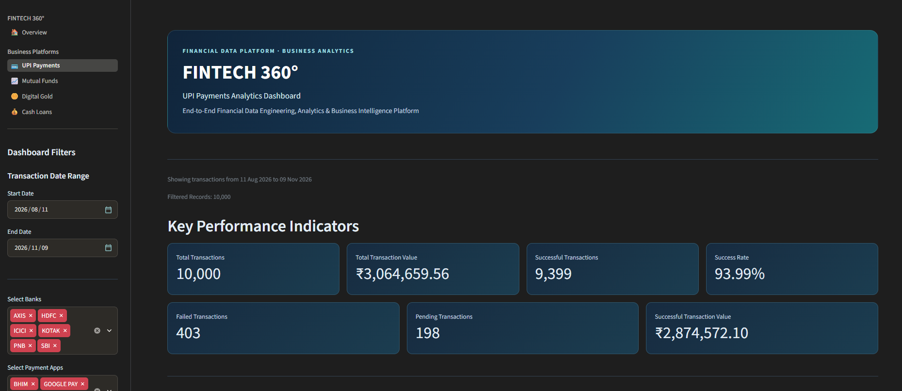

**Daily Transaction Trends**

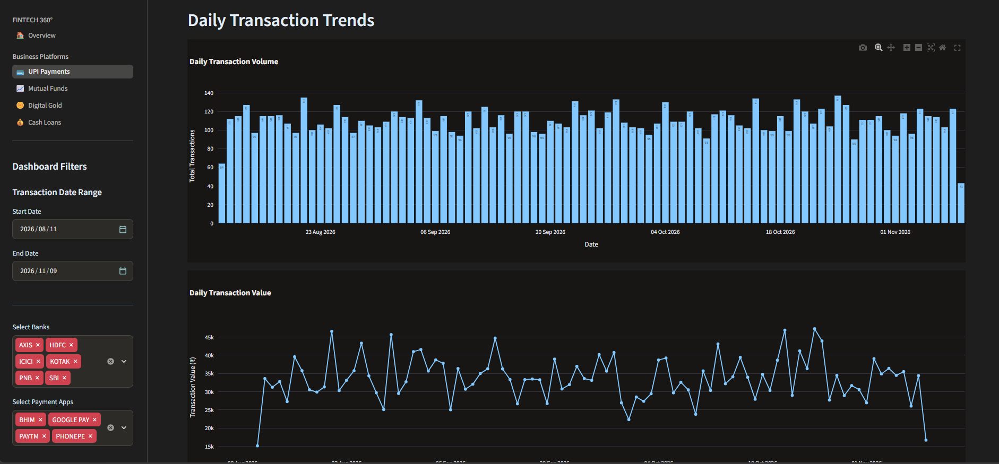

**Bank Performance Analysis**

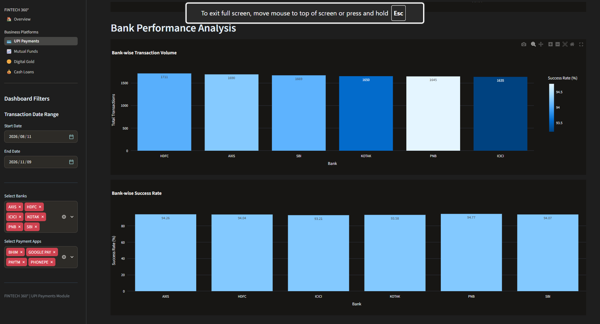

**Payment App Performance**

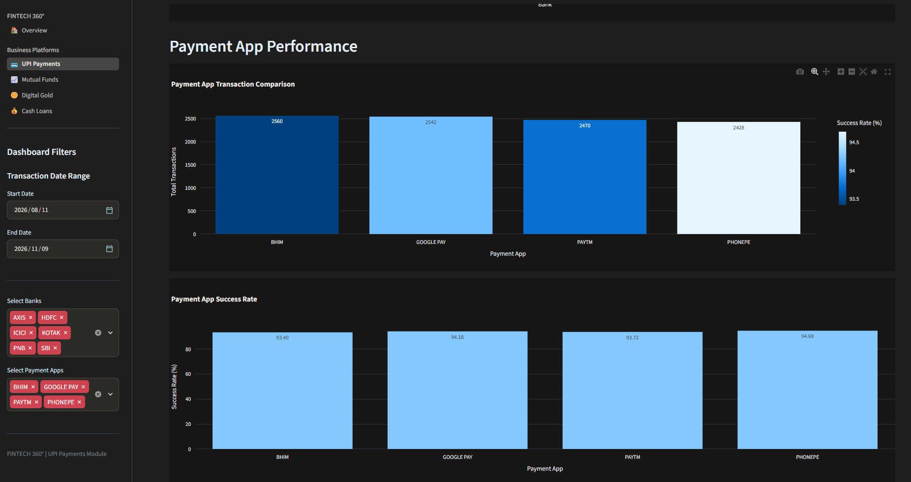

**Transaction Data Explorer**

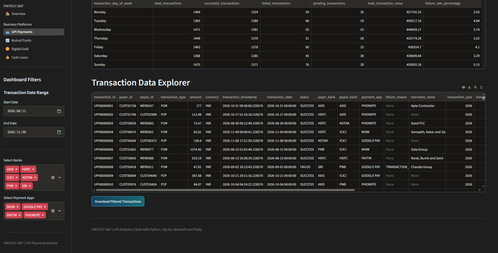

### UPI Documentation

- [Architecture](docs/UPI_ARCHITECTURE.md)
- [Data Quality](docs/UPI_DATA_QUALITY.md)
- [Pipeline Execution](docs/UPI_PIPELINE_EXECUTION.md)
- [Analytics & Business Insights](docs/UPI_ANALYTICS_AND_BUSINESS_INSIGHTS.md)

---

## 2. Mutual Funds

**Status: Implemented**

The Mutual Funds module analyzes investor activity, mutual fund schemes, NAV history, and investment transactions.

**Implemented components**

- Synthetic investor and scheme data.
- Mutual fund transaction data ingestion.
- NAV history processing.
- Data validation and transformation.
- SQLite warehouse loading.
- SQL analytical data marts.
- Investor and scheme performance analytics.
- Investment mode and category analysis.
- Business insights and interactive dashboard.

**Dataset**

- 1,000 investors.
- 20 mutual fund schemes.
- 9,700 NAV records.
- 20,000 investment transactions.

**Validation results**

- 39/39 data quality checks passed.
- 12 SQL validation queries.
- 36/36 analytical mart checks passed.
- 42/42 analytics checks passed.
- 33/33 business insights checks passed.

**Key analytical areas**

- Investor segment distribution.
- Scheme-wise purchase and net investment.
- SIP, lump-sum, and redemption analysis.
- Monthly investment trends.
- Investor behavior and top investors.

**Metric definition:** Net investment represents successful purchase amounts minus successful redemption amounts. It is not NAV-based investment return or assets under management (AUM).

### Mutual Funds Dashboard Screenshots

**Dashboard Overview**

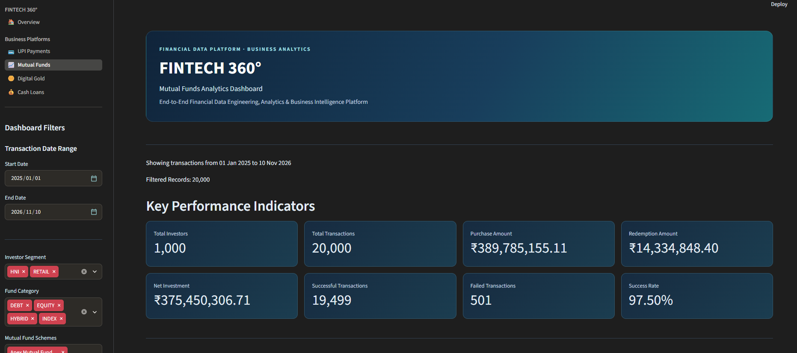

**Scheme Performance**

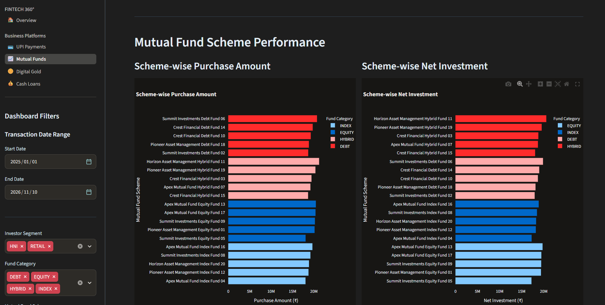

**Investment Mode Analysis**

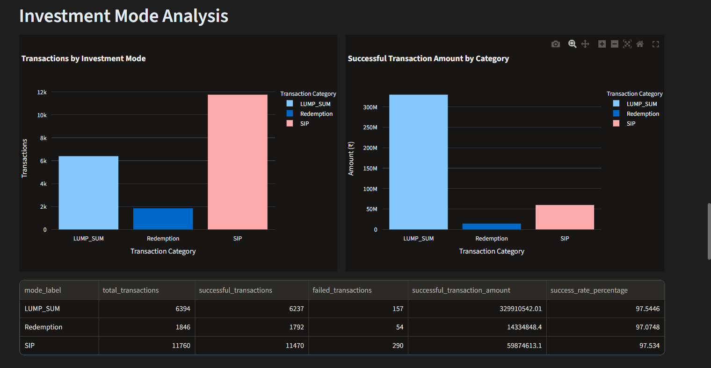

**Monthly Investment Trends**

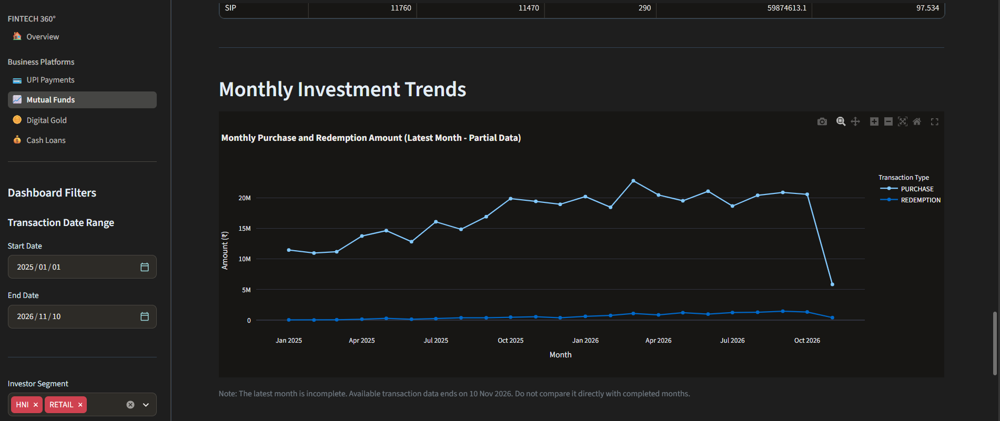

**Investor Behaviour**

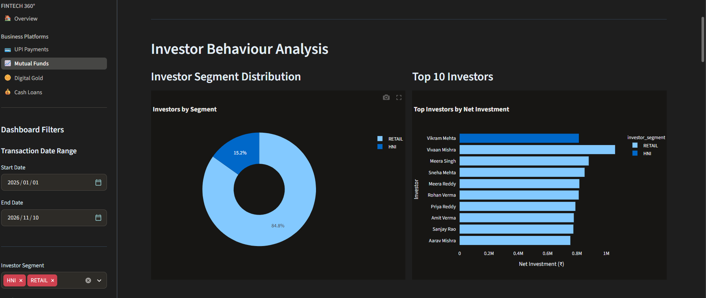

### Mutual Funds Documentation

- [Architecture](docs/MUTUAL_FUNDS_ARCHITECTURE.md)
- [Data Quality](docs/MUTUAL_FUNDS_DATA_QUALITY.md)
- [Pipeline Execution](docs/MUTUAL_FUNDS_PIPELINE_EXECUTION.md)
- [Analytics & Business Insights](docs/MUTUAL_FUNDS_ANALYTICS_AND_BUSINESS_INSIGHTS.md)

---

## 3. Digital Gold

**Status: Implemented**

The Digital Gold module analyzes customer transactions, gold purchases and sales, price history, and wallet ledger activity.

**Implemented components**

- Synthetic customer and gold price data.
- BUY and SELL transaction ingestion.
- Wallet ledger processing.
- Data validation and transformation.
- SQLite warehouse loading.
- SQL analytical data marts.
- Customer behavior analytics.
- Gold transaction and quantity analysis.
- Business insights and interactive dashboard.

**Dataset**

- 5,000 customers.
- 700 gold price records.
- 50,000 transactions.
- 48,789 wallet ledger entries.

**Validation results**

- 45/45 raw data quality checks passed.
- 45/45 mart quality checks passed.
- 51/51 analytics quality checks passed.
- 47/47 business insights quality checks passed.

**Key analytical areas**

- Customer segment distribution.
- Customer behavior and top customers.
- Successful BUY and SELL amounts.
- Gold quantity accumulation.
- Transaction mode analysis.
- Daily and monthly transaction trends.

**Metric definition:** Net gold quantity represents successful BUY quantity minus successful SELL quantity. It is not a portfolio valuation or investment return.

### Digital Gold Dashboard Screenshots

**Dashboard Overview**

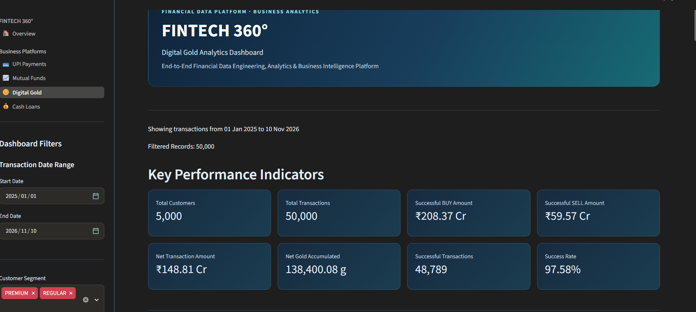

**Customer Behaviour**

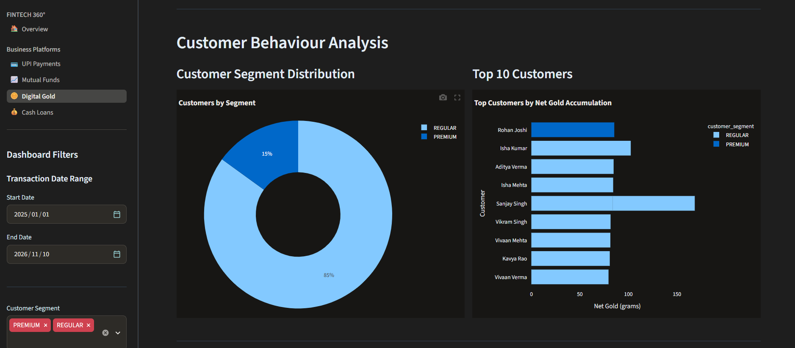

**BUY and SELL Performance**

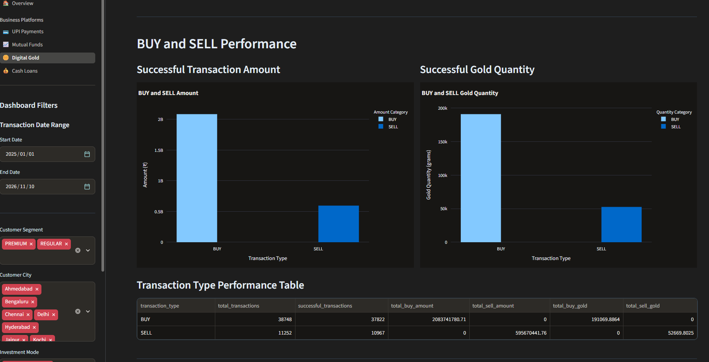

### Digital Gold Documentation

- [Architecture](docs/DIGITAL_GOLD_ARCHITECTURE.md)
- [Data Quality](docs/DIGITAL_GOLD_DATA_QUALITY.md)
- [Pipeline Execution](docs/DIGITAL_GOLD_PIPELINE_EXECUTION.md)
- [Analytics & Business Insights](docs/DIGITAL_GOLD_ANALYTICS_AND_BUSINESS_INSIGHTS.md)

---

## 4. Cash Loans

**Status: Implemented**

The Cash Loans module analyzes the complete loan lifecycle, from customer applications and approvals to disbursements and repayments.

**Implemented components**

- Synthetic customer and loan product data.
- Loan application ingestion.
- Application validation and transformation.
- Loan disbursement processing.
- Repayment and installment processing.
- SQLite warehouse loading.
- SQL analytical data marts.
- Loan product and customer analytics.
- Repayment and overdue risk analysis.
- Business insights and interactive dashboard.

**Dataset**

- 5,000 customers.
- 8 loan products.
- 15,000 loan applications.
- 8,185 disbursements.
- 138,744 repayment installments.

**Validation results**

- 80/80 raw data quality checks passed.
- 21/21 financial reconciliation checks passed.
- 82/82 analytics quality checks passed.
- 82/82 business insights quality checks passed.

**Key analytical areas**

- Loan application and approval performance.
- Loan product comparison.
- Successful loan disbursement analysis.
- Repayment status distribution.
- Amount due, collected, and outstanding.
- Overdue installment analysis.
- Monthly loan flow trends.

**Metric definitions**

- Successful disbursed amounts include successful disbursements only.
- Overdue outstanding represents installments classified as OVERDUE.
- Repayment collection rate is calculated as amount collected divided by total repayment due, including pending future installments. It should not be interpreted as a mature-loan recovery rate.

### Cash Loans Dashboard Screenshots

**Dashboard Overview**

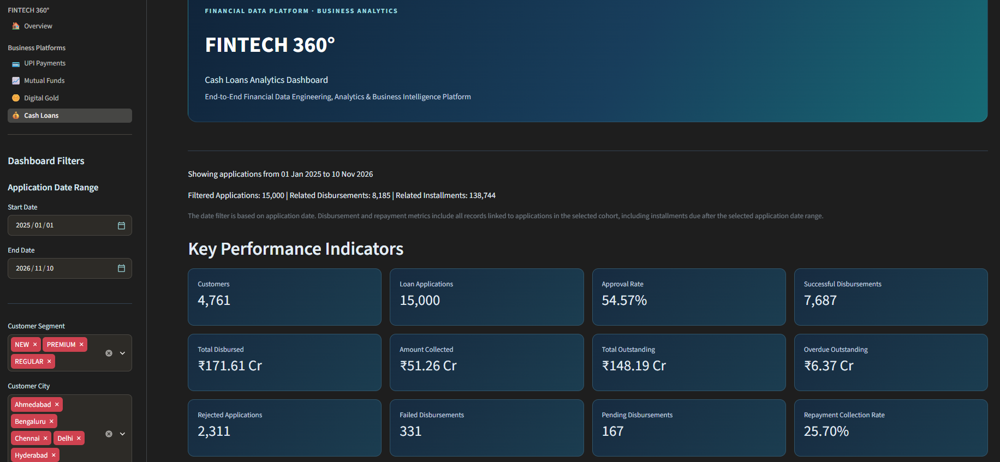

**Loan Product Performance**

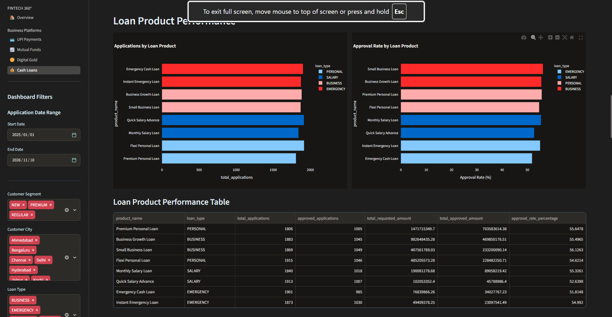

**Repayment and Credit Risk**

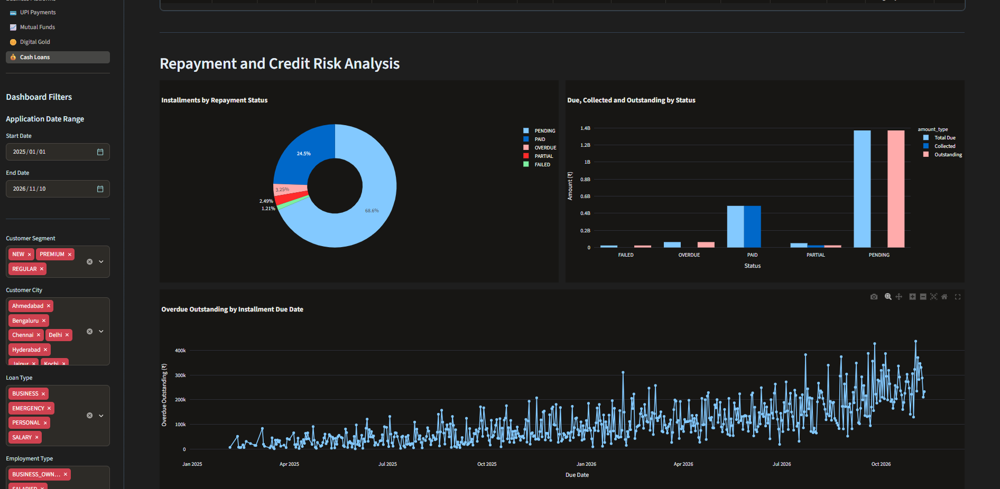

**Monthly Loan Flow Trends**

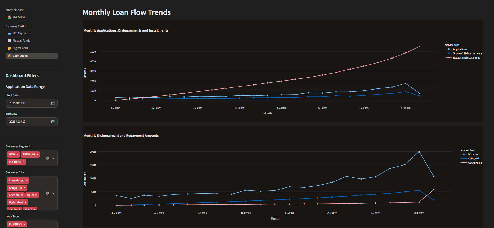

### Cash Loans Documentation

- [Architecture](docs/CASH_LOANS_ARCHITECTURE.md)
- [Data Quality](docs/CASH_LOANS_DATA_QUALITY.md)
- [Pipeline Execution](docs/CASH_LOANS_PIPELINE_EXECUTION.md)
- [Analytics & Business Insights](docs/CASH_LOANS_ANALYTICS_AND_BUSINESS_INSIGHTS.md)

---

# Unified Executive Dashboard

FINTECH 360° includes a unified Streamlit application that brings all four financial domains together.

The Overview dashboard provides:

- Portfolio-wide domain summary.
- UPI transaction performance.
- Mutual Fund investment performance.
- Digital Gold transaction and quantity metrics.
- Cash Loan application and repayment metrics.
- Cross-domain performance visualizations.
- Business highlights.
- Platform architecture and technology overview.

### Executive Dashboard Screenshots

**Portfolio Overview**

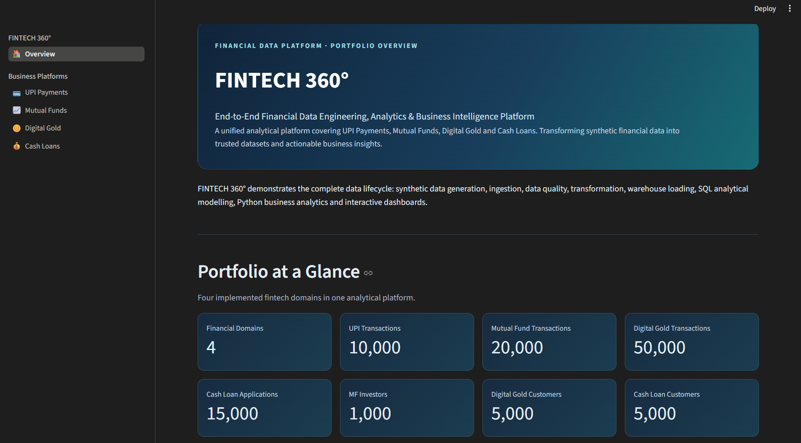

**Domain Performance KPIs**

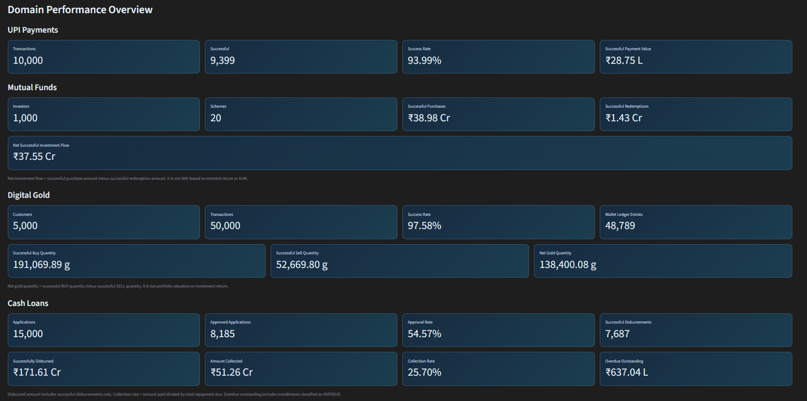

---

# Repository Structure

```text
fintech-360/
|
|-- config/
|
|-- data/
|   |-- raw/
|   |   |-- upi/
|   |   |-- mutual_funds/
|   |   |-- digital_gold/
|   |   |-- cash_loans/
|   |
|   |-- processed/
|   |-- rejected/
|   |-- curated/
|   |-- warehouse/
|
|-- docs/
|   |-- images/
|   |-- UPI_*.md
|   |-- MUTUAL_FUNDS_*.md
|   |-- DIGITAL_GOLD_*.md
|   |-- CASH_LOANS_*.md
|   |-- FINTECH_360_ARCHITECTURE.md
|   |-- FINTECH_360_EXECUTION_GUIDE.md
|
|-- logs/
|
|-- notebooks/
|
|-- sql/
|   |-- ddl/
|   |-- transformations/
|   |-- marts/
|
|-- src/
|   |-- ingestion/
|   |-- transformation/
|   |-- quality/
|   |-- common/
|   |-- analytics/
|   |-- dashboard/
|
|-- tests/
|
|-- .gitignore
|-- LICENSE
|-- README.md
|-- requirements.txt
```

---

# Getting Started

## Prerequisites

- Python 3.12
- Git
- pip
- Windows, macOS, or Linux

## 1. Clone the repository

```bash
git clone https://github.com/shaikgousefintech-creator/fintech-360.git
cd fintech-360
```

## 2. Create a virtual environment

```bash
python -m venv .venv
```

## 3. Activate the environment

**Windows PowerShell**

```powershell
.venv\Scripts\Activate.ps1
```

## 4. Install dependencies

```bash
pip install -r requirements.txt
```

## 5. Launch the unified dashboard

```bash
python -m streamlit run src/dashboard/app.py
```

The application opens the FINTECH 360° Overview dashboard, from which users can navigate to UPI Payments, Mutual Funds, Digital Gold, and Cash Loans.

## Pipeline Execution and Testing

Each domain has its own documented pipeline execution process.

Refer to the relevant execution guide before running a domain pipeline:

- [UPI Pipeline Execution](docs/UPI_PIPELINE_EXECUTION.md)
- [Mutual Funds Pipeline Execution](docs/MUTUAL_FUNDS_PIPELINE_EXECUTION.md)
- [Digital Gold Pipeline Execution](docs/DIGITAL_GOLD_PIPELINE_EXECUTION.md)
- [Cash Loans Pipeline Execution](docs/CASH_LOANS_PIPELINE_EXECUTION.md)
- [FINTECH 360° Execution Guide](docs/FINTECH_360_EXECUTION_GUIDE.md)

Run the automated test suite:

```bash
python -m pytest tests/ -v
```

---

# Data Quality and Reliability

Data quality is implemented throughout the platform to improve data reliability and analytical consistency.

The project includes:

- Required field validation.
- Duplicate record detection.
- Data type and format validation.
- Date and timestamp validation.
- Transaction status validation.
- Financial amount and quantity validation.
- Rejected-record handling.
- SQL-based validation.
- Analytical mart reconciliation.
- Domain-specific quality checks.
- Automated testing with Pytest.

Each domain has dedicated documentation describing its validation rules and quality results.

# Monitoring and Logging

Python logging is used to record pipeline execution information, including:

- Pipeline execution start and completion.
- Individual pipeline stages.
- Stage execution details.
- Failed stages and error information.
- Execution summaries.

Pipeline logs are maintained within the project's logs directory.

# Future Enhancements

Potential extensions to the platform include:

- Distributed data processing using Apache Spark.
- Hadoop ecosystem integration.
- Scalable data lake and Parquet storage.
- Advanced orchestration and monitoring.
- Cloud-based deployment.
- Expanded analytics and reporting.

# Disclaimer

FINTECH 360° is an educational and portfolio demonstration project.

All financial and customer datasets are synthetic. The project does not contain real customer information, actual financial transactions, or production financial records.

Business findings and dashboard metrics represent the synthetic datasets and should not be interpreted as real-world financial performance.

# Author

**FINTECH 360°**
An end-to-end financial data engineering, analytics, and business intelligence portfolio project.

**GitHub Repository:**

https://github.com/shaikgousefintech-creator/fintech-360
