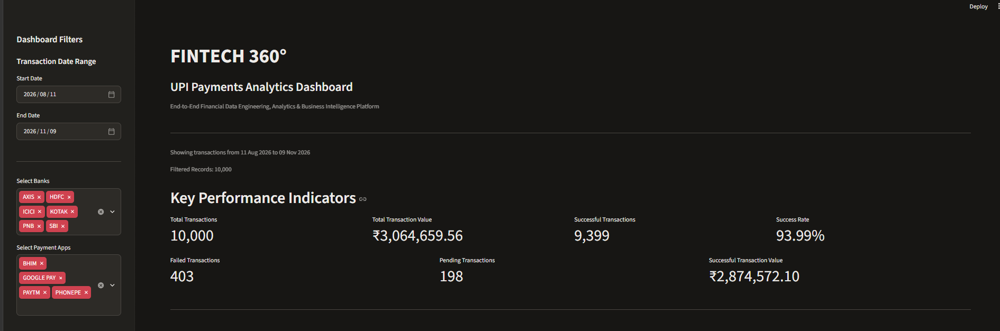
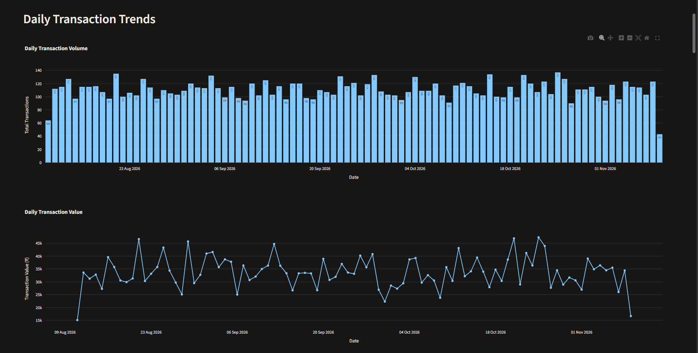
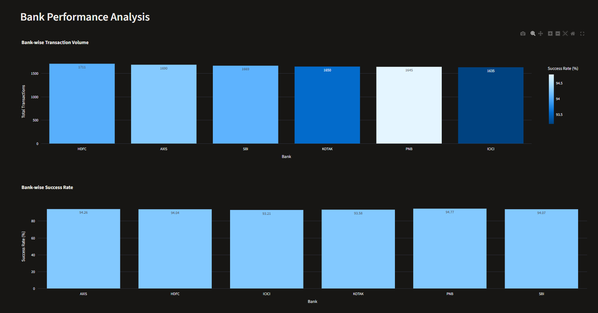
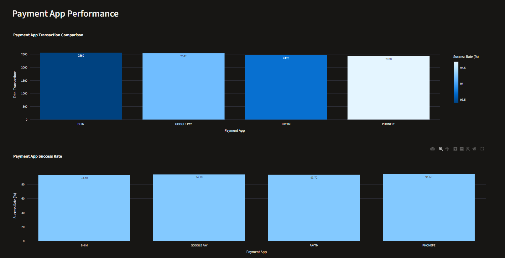
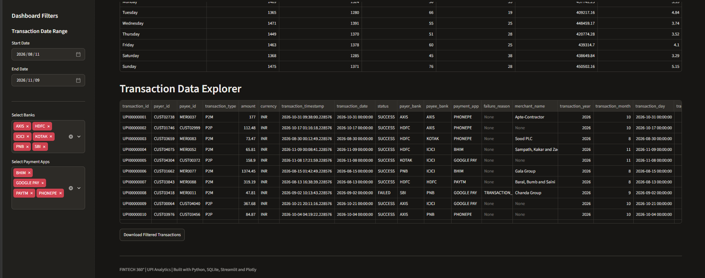

# FINTECH 360°

### End-to-End Financial Data Engineering, Analytics & Business Intelligence Platform

FINTECH 360° is an end-to-end financial data engineering and analytics portfolio project demonstrating how financial transaction data can be ingested, validated, transformed, stored, analyzed, and presented through interactive dashboards.

The platform covers four fintech domains:

- Mutual Funds
- Digital Gold
- UPI Payments
- Cash Loans

The project uses synthetic financial data to demonstrate practical data engineering workflows without exposing real customer information.

---

## Project Objectives

- Build an end-to-end financial data pipeline.
- Implement data ingestion and validation.
- Apply data cleaning and transformation techniques.
- Store structured data in a centralized analytical database.
- Develop SQL-based analytical models and business insights.
- Build interactive dashboards for business users.
- Demonstrate data quality, reconciliation, and pipeline orchestration.

## Technology Stack

| Area | Technologies |
|---|---|
| Programming | Python |
| Data Processing | Pandas |
| Database | SQLite |
| Query Language | SQL |
| Visualization | Streamlit, Plotly |
| Testing | Pytest |
| Version Control | Git, GitHub |

## Project Architecture

The platform follows this general workflow:

```text
Synthetic Financial Data
         |
         v
    Data Ingestion
         |
         v
  Data Quality Checks
         |
         v
  Data Transformation
         |
         v
  SQLite Data Warehouse
         |
         v
  SQL Analytics & Marts
         |
         v
Business Insights & Dashboards
```

## Documentation

Detailed documentation for the implemented UPI module is available below:

| Document | Description |
|---|---|
| [UPI Architecture](docs/UPI_ARCHITECTURE.md) | UPI pipeline architecture and component overview |
| [UPI Data Quality](docs/UPI_DATA_QUALITY.md) | Data validation rules and quality results |
| [UPI Pipeline Execution](docs/UPI_PIPELINE_EXECUTION.md) | Pipeline stages and execution instructions |
| [UPI Analytics & Business Insights](docs/UPI_ANALYTICS_AND_BUSINESS_INSIGHTS.md) | Business insights, transaction failure analysis, and time-based analysis |

## Project Modules

### 1. UPI Payments

**Status: Core pipeline and analytics implemented**

The UPI module demonstrates an end-to-end financial transaction data pipeline.

**Implemented components:**

- Synthetic UPI transaction data generation.
- CSV-based data ingestion.
- Data validation and rejected-record handling.
- Data standardization and transformation.
- Analytical column creation.
- SQLite data loading.
- SQL-based data validation.
- Analytical data marts.
- Data quality and reconciliation checks.
- Pipeline orchestration and execution logging.
- Interactive Streamlit dashboard.
- Business insights, transaction failure analysis, and time-based analysis.

**Current dataset:** 10,000 synthetic UPI transactions.

**Validation results:**

- 10,000 raw records.
- 10,000 processed records.
- 0 rejected records.
- 10,000 curated records.
- 10,000 records loaded into SQLite.
- 10 data quality checks passed.
- 24 analytical mart reconciliation checks passed.
- 35 automated pytest tests passed.

### UPI Dashboard Screenshots

The UPI module includes an interactive Streamlit dashboard that provides insights into transaction performance, daily trends, bank performance, and payment application performance.

**1. Dashboard Overview**



**2. Daily Transaction Trends**



**3. Bank Performance Analysis**



**4. Payment App Performance**



**5. Transaction Data Explorer**




### 2. Mutual Funds

**Status: Planned**

Planned scope:

- Investment transaction data.
- Mutual fund scheme performance.
- Investor portfolio analysis.
- SIP and lump-sum investment analytics.

### 3. Digital Gold

**Status: Planned**

Planned scope:

- Digital gold purchase and sell transactions.
- Gold holdings and portfolio valuation.
- Price movement analysis.
- Customer investment behavior.

### 4. Cash Loans

**Status: Planned**

Planned scope:

- Loan application and disbursement data.
- Repayment tracking.
- Outstanding loan analysis.
- Delinquency and repayment performance.

## Repository Structure

```text
fintech-360/
|
|-- config/
|
|-- data/
|   |-- raw/
|   |-- processed/
|   |-- rejected/
|   |-- curated/
|   |-- warehouse/
|
|-- docs/
|
|-- logs/
|
|-- notebooks/
|
|-- sql/
|   |-- ddl/
|   |-- transformations/
|   |-- marts/
|
|-- src/
|   |-- ingestion/
|   |-- transformation/
|   |-- quality/
|   |-- common/
|   |-- analytics/
|   |-- dashboard/
|
|-- tests/
|
|-- .gitignore
|-- LICENSE
|-- README.md
|-- requirements.txt
```

## Running the UPI Pipeline

### Prerequisites

- Python 3.12
- Git
- Required project dependencies
- Windows, macOS, or Linux environment

### 1. Clone the repository

```bash
git clone https://github.com/shaikgousefintech-creator/fintech-360.git
cd fintech-360
```

### 2. Create a virtual environment

```bash
python -m venv .venv
```

### 3. Activate the environment

Windows PowerShell:

```powershell
.venv\Scripts\Activate.ps1
```

### 4. Install dependencies

```bash
pip install -r requirements.txt
```

### 5. Run the complete UPI pipeline

```bash
python src/common/run_upi_pipeline.py
```

The orchestrator executes the pipeline stages in sequence:

1. Data ingestion.
2. Data quality validation.
3. Data transformation.
4. SQLite data loading.
5. SQL validation.
6. Mart quality validation.
7. UPI failure analysis.
8. UPI time analysis.
9. UPI analytics.
10. UPI business insights.

The orchestrator stops execution if a stage fails and records execution details in the pipeline log.

### 6. Run automated tests

```bash
python -m pytest tests/ -v
```

### 7. Launch the UPI dashboard

```bash
python -m streamlit run src/dashboard/upi_dashboard.py
```

## UPI Dashboard

The UPI dashboard provides interactive analysis of:

- Total transactions and transaction value.
- Successful, failed, and pending transactions.
- Transaction success rate.
- Daily transaction trends.
- Bank-wise performance.
- Payment application performance.
- Filtered transaction exploration.
- CSV export of filtered records.

## Data Quality and Reliability

The UPI pipeline includes validation at multiple stages:

- Required field validation.
- Duplicate transaction ID detection.
- Positive transaction amount validation.
- Timestamp validation.
- Transaction status validation.
- Failure reason validation.
- Merchant information validation.
- SQL-based data validation.
- Analytical mart reconciliation.

Automated tests cover ingestion, analytics, business insights, and data quality validation.

## Pipeline Monitoring and Logging

The pipeline uses Python logging to record:

- Pipeline execution start and completion.
- Individual stage execution.
- Stage execution time.
- Failed stages and error details.
- Overall pipeline execution summary.

Execution logs are stored in:

```text
logs/upi_pipeline.log
```

## Future Enhancements

- Complete Mutual Funds, Digital Gold, and Cash Loans modules.
- Integrate all financial domains into a unified analytical warehouse.
- Expand automated testing and pipeline monitoring.
- Expand business intelligence dashboards.
- Improve deployment and documentation.

## Disclaimer

This project uses synthetic data for educational and portfolio demonstration purposes. It does not contain real customer or financial transaction records.

## Author

**FINTECH 360°** — A practical portfolio project demonstrating end-to-end financial data engineering, analytics, and business intelligence.

**GitHub Repository:** [FINTECH 360°](https://github.com/shaikgousefintech-creator/fintech-360)